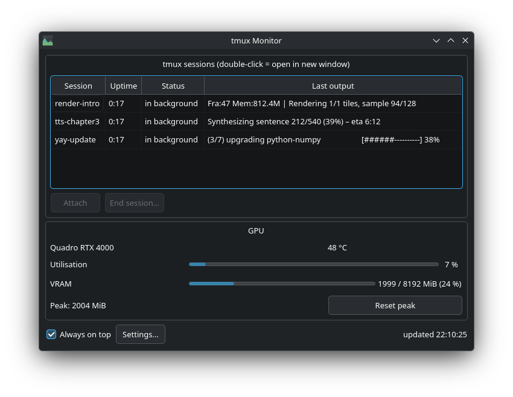

# tmux Monitor

A small desktop window (PyQt6) that lists your running **tmux sessions** with
their last line of output, plus live **NVIDIA GPU** usage. Double-click a
session to attach to it in a new terminal window.

Handy for keeping an eye on long jobs (installs, renders, model training,
TTS, …) that run detached in tmux.



## Features

- All tmux sessions with uptime, attached/background status and the last
  non-empty output line (progress bars that redraw with `\r` show up correctly)
- Double-click opens `tmux attach` in a terminal: `$TERMINAL`, otherwise
  `konsole` → `gnome-terminal` → `xterm`
- GPU name, temperature, utilisation, VRAM and VRAM peak (via `nvidia-smi`);
  the GPU panel is hidden automatically when there is no NVIDIA GPU
- Attach/Detach button and "End session…" (with confirmation)
- Optional session archive: output of ended sessions stays readable
  (see below; needs tmux 3.2+)
- Settings dialog: start at login, always on top at startup, language,
  session archive (enable, compact), install/update via yay
- "Always on top" toggle
- English and German UI (gettext): system locale, or choose in Settings…

## Requirements

| Package | Arch Linux | Debian / Ubuntu | |
| --- | --- | --- | --- |
| Python 3.8+ with PyQt6 | `python-pyqt6` | `python3-pyqt6` | required |
| tmux | `tmux` | `tmux` | required |
| nvidia-smi | `nvidia-utils` | `nvidia-utils-<version>` | optional (GPU panel) |
| gettext | `gettext` | `gettext` | optional (German UI) |

```sh
# Arch
sudo pacman -S --needed python-pyqt6 tmux gettext   # + nvidia-utils if you have an NVIDIA GPU
```

## Install

### Arch Linux (makepkg / yay)

The `PKGBUILD` builds the package `tmux-monitor-git` from the repository:

```sh
git clone https://github.com/petter1/tmux-monitor-gui.git
cd tmux-monitor-gui
yay -Bi .          # or: makepkg -si
```

It installs to `/usr/bin`, `/usr/share/applications` and `/usr/share/locale`.

When you run the app from the cloned folder, **Settings… → Install / update
with yay** does the same in a tmux session and opens it in a terminal
for your password.

### Other distributions (user-local)

```sh
git clone https://github.com/petter1/tmux-monitor-gui.git
cd tmux-monitor-gui
./install.sh
```

`install.sh` only writes to `~/.local` (no sudo):

- `~/.local/bin/tmux-monitor`
- `~/.local/share/applications/tmux-monitor.desktop` (app menu entry)
- `~/.local/share/locale/*/LC_MESSAGES/tmux-monitor.mo`
- `~/.local/bin/tmux-monitor-archive`, `~/.config/tmux-monitor/archive.tmux`

Uninstall with `./install.sh --uninstall`.

## Usage

```sh
tmux-monitor                  # or start "tmux Monitor" from the app menu
tmux-monitor --interval 5     # refresh every 5 s (default: 2)
tmux-monitor --lang de        # force German UI
TERMINAL=alacritty tmux-monitor
```

Without installing: `python3 tmux_monitor.py` (run `./i18n.sh compile` first
for the German UI).

Start a long job so it shows up in the monitor:

```sh
tmux new-session -d -s render 'blender -b scene.blend -a'
```

### Terminal

`$TERMINAL` may include arguments. The command is appended with `-e`, except
for terminals that need something else (`gnome-terminal --`, `kitty`,
`wezterm start --`). If `$TERMINAL` already ends with `-e`, `-x` or `--`,
nothing is added.

## Session archive (optional)

`tmux-monitor-archive` keeps the output of every tmux pane after the session
has ended, e.g. to find out later why an overnight install failed.

A tmux hook (`pipe-pane`) writes each pane's raw output to
`~/.local/state/tmux-monitor/archive/` (override with `$TMUX_MONITOR_ARCHIVE`).
Files are created with mode `600`.

**Enable it in the app:** *Settings… → Session archive*. This adds one line
to your `tmux.conf`, applies it to the running tmux server and starts
recording panes that are already running. The same dialog shows the archive
size, compacts it and opens the folder. When the archive grows beyond
200 MB, the main window shows a hint.

Manual alternative: add `source-file -q ~/.config/tmux-monitor/archive.tmux`
to your `tmux.conf` (`install.sh` creates that file).

```sh
tmux-monitor-archive list               # all archived panes (--json available)
tmux-monitor-archive show render        # cleaned text of the latest "render" session
tmux-monitor-archive show render --tail 50
tmux-monitor-archive status             # size; recommends compaction above 200 MB
tmux-monitor-archive compact            # clean + gzip logs of ended sessions
tmux-monitor-archive compact --older-than 7 --dry-run
```

`compact` strips escape sequences, collapses progress-bar redraws and
gzips the result. Running sessions are never touched.

> **Privacy:** the archive contains everything shown in your terminals,
> possibly including tokens or passwords that were printed. Nothing is
> deleted automatically; remove files from the archive directory as needed.

## Claude Code plugin

This repository is also a [Claude Code](https://code.claude.com) plugin
(and its own marketplace). It adds the skill `tmux-monitor`, which makes
Claude:

- start long jobs (installs, builds, renders, TTS, …) in a named tmux
  session, so you can watch them in tmux Monitor, and tell you the session
  name and how to attach;
- follow the job with `tmux capture-pane` and report the result;
- read the session archive when it helps (e.g. "why did last night's
  install fail?"), and suggest compacting it when it grows large.

Install in Claude Code:

```text
/plugin install tmux-monitor --marketplace petter1/tmux-monitor-gui
```

or, on older versions:

```text
/plugin marketplace add petter1/tmux-monitor-gui
/plugin install tmux-monitor@tmux-monitor
```

Without the plugin system, copy `skills/tmux-monitor/` to
`~/.claude/skills/tmux-monitor/` to use it in all your Claude Code sessions.

## Translations

Strings are marked as `_("context", "text")` (xgettext keyword `_:1c,2`).

```sh
./i18n.sh                                         # update po/tmux-monitor.pot and po/*.po, compile to ./locale
msginit -i po/tmux-monitor.pot -l fr -o po/fr.po  # add a language
```

## License

MIT, see [LICENSE](LICENSE).
